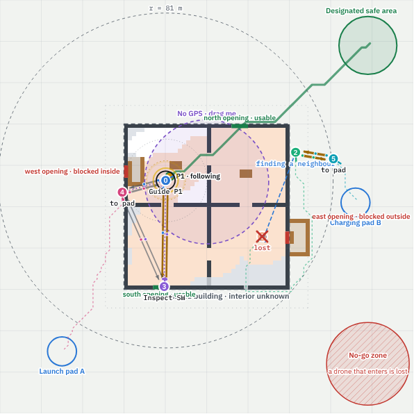

# Mission 1: decentralized multi-UAV search and guided evacuation

Interactive demo: open [`tools/mission1_evacuation.html`](../tools/mission1_evacuation.html) in a
browser. It runs entirely in the page (no server, no build step).

<p align="center"></p>

This is a **visual architecture prototype**. It has a binary Merkle task tree, connectivity
maintenance and leaf claiming, but no consensus algorithm in the Olfati-Saber sense. The goal is to
show the pieces of Mission 1 working together under decentralization, partial observability and
failures, so we can decide what the Python and Gazebo/ROS 2 versions need to contain. See
[ADR 0002](decisions/0002-mission1-browser-prototype.md).

## Setting

| Element | In the demo |
|---|---|
| Area | 200 m x 200 m, occupancy grid of 2 m cells |
| Building | 78 m x 78 m frame in the middle, one cross wall (4 rooms, one door per wall half), seeded rubble piles |
| Openings | 4 gaps in the outer wall, **none known in advance**. South and north are usable; west is blocked by rubble inside; east is blocked by a facade collapse outside. Drones find them and choose where to go in; the escape route picks whichever works |
| Pads | launch pad A (bottom left, all drones start here) and charging pad B (east side). Drones charge at the nearest pad |
| Designated safe area | top right |
| No-go zone | bottom-right corner. A known geofence; a drone that enters is lost |
| No-GPS zone | draggable circle, default over the building |
| People | scenario A: one person. Scenario B: three people (demanding: competing guidance and tracking demands) |
| Aftershock | optional: drops rubble on an active escape route |

## Swarm

Default 6 drones at launch pad A (4 to 10 adjustable). Four leaves are open at the start, two
outside and two inside, so 4 drones launch and the rest wait as backups. Every drone has a Jetson-class
GPU, obstacle avoidance, light, speaker, optical + thermal + lidar and a small arm, at different
quality levels, so capabilities overlap:

| Type | Role | thermal | optical | lidar | beacon | radio | GPU | arm | v<sub>max</sub> |
|---|---|---|---|---|---|---|---|---|---|
| Scout | lidar mapper | 0.35 | 0.6 | **1.0** | 0.35 | 0.5 | 0.6 | 0.2 | 4.5 m/s |
| Seeker | thermal searcher | **1.0** | 0.8 | 0.5 | 0.5 | 0.5 | **1.0** | 0.3 | 3.5 m/s |
| Watcher | outside inspector | 0.4 | **1.0** | 0.7 | 0.3 | 0.8 | 0.6 | 0.1 | 4.0 m/s |
| Herald | guide | 0.6 | 0.6 | 0.45 | **1.0** | 0.6 | 0.7 | **0.8** | 3.0 m/s |
| Relay | long-range radio | 0.3 | 0.7 | 0.5 | 0.4 | **1.0** | 0.5 | 0.2 | 5.0 m/s |

Order at the pad: D0 Scout, D1 Seeker, D2 Watcher, D3 Watcher, D4 Herald, D5 Relay, then repeating.

**State vector** each drone broadcasts: node ID, r (heading), p̂ ± σ (estimated position), v,
battery, health, N<sub>i</sub> (neighbours), plus its leaf, capabilities, root hash and network flags.

## The task tree

A binary Merkle tree. The root is the goal; the top layers are fixed and vague; drones claim the
lowest leaves.

```
ROOT  Everyone in the safe area
├── Find people
│   ├── Search inside                        leaf
│   └── Track found people                   one leaf per person, added on a find
└── Get them out
    ├── Escape routes
    │   ├── Map inside + routes              leaf
    │   └── Outside
    │       ├── Inspect outside SW           leaf
    │       └── Inspect outside NE           leaf
    └── Guide people out                     one leaf per person, added on a find
```

- **Hashes.** A leaf hashes (id, claimant, done); an internal node hashes its two children (FNV-1a,
  32 bit). Two drones with the same root hash hold the same tree. Neighbours compare root hashes in
  the state vector and send tree updates only when they differ.
- **Each drone has its own copy**, built only from what its neighbours send. Copies converge with the
  same merge rule everywhere: newer claim wins for the same drone; a release and a claim are ordered
  by time; two live claims → the better-suited drone keeps the leaf (lower ID on a tie); a claim
  whose drone has been silent for 2 × the heartbeat timeout is stale and loses; "done" never reverts.
- **Claiming.** A free drone runs a greedy assignment over the open leaves and the free teammates it
  has heard from recently, and claims its own pick if score = priority × capability fit × battery
  factor − distance cost reaches the **claim threshold**. Drones skip leaves that are taken. A drone
  keeps its leaf until the leaf's success criteria hold. Exceptions:
  - two drones **in radio range** may swap leaves if that raises their summed score by 0.15;
  - **priority threshold**: if a leaf has been open for 30 s and has a priority at least 0.15
    higher, the best-suited drone holding a lower-priority leaf drops its leaf and takes it;
  - a drone with low battery releases its leaf and flies to the nearest pad.
- **Success criteria** (checked by any drone on its own knowledge, so any drone can mark a leaf done):

  | Leaf | Done when |
  |---|---|
  | Search inside | ≥ 90 % of the floor thermal-searched |
  | Map inside + routes | ≥ 85 % mapped and every found person's escape route fully known |
  | Inspect outside SW / NE | search done and everyone found is safe |
  | Track P<sub>k</sub> | a guide has the person |
  | Guide P<sub>k</sub> | the person is in the safe area |
  | Relay for D<sub>k</sub> | D<sub>k</sub> no longer needs it |
  | Localize D<sub>k</sub> | σ ≤ 2 m |
  | Re-map route P<sub>k</sub> | that escape route is known again |

- **Edge cases → local sub-trees.** A drone that hits a problem on its own leaf splits that leaf into
  [original, new sub-leaf]. For 15 s, only drones within 2 hops of it may claim the sub-leaf (local
  sub-consensus); after that it escalates to everyone. The sub-leaves are:
  - *Relay for D<sub>k</sub>*: the drone is at the edge of its critical link and can't go further.
    This is how the number of drones inside grows when two isn't enough.
  - *Localize D<sub>k</sub>*: no GPS inside, σ > 2.5 m.
  - *Re-map route P<sub>k</sub>*: new debris on an escape route, and the detour runs through unmapped floor.
- **Consensus = root done.** When every leaf in a drone's own tree is done, the root is reached and
  the drone flies to a pad. The mission is complete when everyone is safe and every drone has
  reached its root.
- **Abort.** The *Send abort to selected drone* button tells one drone that the goal no longer holds
  (e.g. the person died, or the building is collapsing). Every hop, each informed drone forwards the
  abort to its uninformed neighbour **with the most neighbours**. Every drone that receives it drops
  its leaf, marks its root cancelled and returns to launch pad A. The map numbers the hops.

## Network: always connected (by design, best effort under failures)

- Links: unit-disk digraph from step 1, plus walls. A link exists iff
  d<sub>ij</sub> ≤ min(r<sub>i</sub>, r<sub>j</sub>) · k<sup>walls</sup>. A wall counts only with
  at least 0.6 m of material on the line, and an existing link holds until 112 % of the range
  (hysteresis). Weight a<sub>ij</sub> = exp(−d²/σ²).
- **Critical links.** Each drone rebuilds the network graph from its neighbours' reported neighbour
  lists. A link is critical if losing it would cut the drone off from some teammate on a leaf, or if
  the neighbour has only two links. A drone never flies out of range of a critical neighbour.
- **Pull and follow.** A drone held back by a critical link broadcasts `pull`. If its leaf has at
  least the neighbour's priority, the neighbour follows it, so a guide can drag its inspector
  along instead of stalling.
- **Backups and drones flying home** are not protected themselves, but they stay while they are the
  only bridge between drones on leaves. They never land while they still hold a critical link.
- **Lost drone.** A drone with no neighbour flies toward the closest teammate's predicted position.
  The prediction is its last known position plus a velocity from the stored message history, as
  reported by the old neighbours. A teammate it reaches without finding anyone is skipped for
  30 s; with nobody left to try, it heads for the launch pad.
- **Docked backups** (by default not part of the connectivity requirement) act only on fresh news
  from a teammate still on a leaf. One that hears nothing for 45 s flies out to check in.
- **Tree updates** go to at most N neighbours per hop (slider), best-connected first.
- **Memory.** Each drone keeps the last H state messages per teammate (slider, default 5) and
  deletes older ones. Maps keep only the newest value per cell.

**Measured:** across 20 headless runs (10 layouts, scenarios A and B, each failure type, 4 and 10
drones) every run completed the mission. The flying network was split for 0 to 54 s per run, out of
3 to 10 minutes of flight, typically around 5 %. The splits come from three sources: a bridge
drone crashing, a follower rounding a building corner, and stale two-hop news. The reconnect
behaviour repairs them. The demo shows this live as *Flying net connected* and as *Network split*
in the metrics.

## Localization

Outside the no-GPS zone σ = 1 m. Inside it the drone dead-reckons (dσ/dt = 0.03 + 0.04|v|). Two
neighbours with σ ≤ 2 m give a range-only fix (through walls); one neighbour with line of sight
gives range + bearing; one neighbour through a wall only halves the drift. Inspectors move along
their patrol line toward a teammate without GPS. While σ > 3 m a drone does not add to its map.

## Success metrics (live panel)

From the mission brief, measured against ground truth:

- Search & tracking: detection rate, time to detection, tracking continuity, tracking recovery time.
- Mapping & routes: coverage, route validity, replanning time, route efficiency (route / shortest).
- Guidance: evacuation success, evacuation time, guidance continuity, guidance recovery time.
- Comms & coordination: time until a find is known to all drones, root-hash agreement, network
  split time, leaf allocation time, duplicate-claim time, tree messages sent vs skipped, swaps.
- Overall: mission complete, drones lost. Architecture comparison against fixed-role or centralized
  baselines is not implemented yet.

## Failure injection

Crash, navigation fault into the no-go zone, lidar fault, radio fault, battery fault. Each can be
scheduled or applied to any drone on demand.

## Not modelled yet

Stairs and multiple floors, vehicle dynamics, realistic radio propagation, survivors who talk back,
the operator after the objective, and the comparison baselines. The Python port (`world.py`,
`agent.py`, `operator.py`) and ROS 2 / Gazebo are in ADR 0002.
